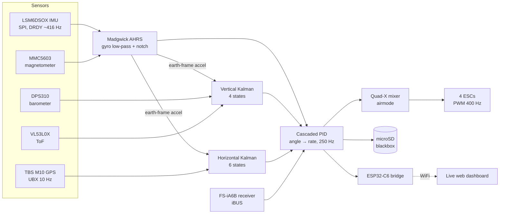

# Drone_FlightCont

[](https://github.com/malek23ma/Drone_FlightCont/actions/workflows/build.yml)


A from-scratch quadrotor flight controller for the **ESP32-S3**, written on ESP-IDF and FreeRTOS. Raw sensors in, Madgwick AHRS, cascaded PID, motors out. No Betaflight, no ArduPilot, no off-the-shelf flight stack: every driver, filter and control loop in this repository was written for this aircraft.

> **Experimental firmware.** It has flown, and it has crashed. It is not airworthy and not certified. There is no plausibility gate on the fusion input yet. Do not put it on an aircraft you care about.

<!-- PHOTO: docs/img/drone.jpg goes here -->

## At a glance

| | |
|---|---|
| **Flight controller** | ESP32-S3, ESP-IDF 5.5 + FreeRTOS, written in C from scratch |
| **Estimation** | Madgwick AHRS (9-DOF, 6-DOF fallback), 4-state vertical Kalman filter (accelerometer + barometer + ToF), 6-state horizontal Kalman filter (accelerometer + GPS) |
| **Control** | Cascaded PID, angle loop → rate loop at 250 Hz, Quad-X mixer with airmode |
| **Sensors** | IMU, barometer, magnetometer, ToF rangefinder, optical flow, GPS, pack voltage monitor |
| **Tooling** | 250 Hz blackbox on microSD, live WiFi dashboard through an ESP32-C6, Python tools for calibration, log decoding and flight replay, host tests in CI |
| **Status** | Flown by hand, summer 2026. Now moving to the **STM32H753**, see [Roadmap](#roadmap) |

## How it works



## Roadmap

### Done on the ESP32-S3

- [x] Own drivers for every part: LSM6DSOX, DPS310, MS5611, MMC5603, VL53L0X, INA226, PMW3901, TBS M10 (UBX), iBUS
- [x] Attitude, altitude and GPS velocity/position estimation
- [x] Manual flight with a pre-arm gate, failsafes and a 200 ms watchdog. Altitude hold and velocity hold are written and off by default
- [x] 250 Hz SD blackbox, decode and replay tools, live dashboard over an ESP32-C6
- [x] IMU freeze traced to the chip's I2C/I3C interface listening on the SPI lines. After the fix: 0 faults in 63.5 minutes armed
- [x] GNSS jamming and spoofing monitor (observer only)

### Next

- [ ] Port to the STM32H753 (in progress)
- [ ] Optical-flow position hold: written and fused into the estimator, waiting for its first flight
- [ ] Plausibility gate on the fusion inputs, the missing safety layer named in the warning above
- [ ] Battery-sag throttle compensation (`thr_vcomp`): written, not flown yet
- [ ] A custom PCB to replace the hand-wired harness

## Hardware

### Airframe

| | |
|---|---|
| AUW | 1173 g (293 g per motor at hover) |
| Motors | 4x SunnySky X2212 980 kV |
| Props | APC 9045 |
| ESC | Eachine 30A BLHeli_S 4-in-1, PWM 400 Hz |
| Battery | 4S, 16.8 V full, 15.0 V floor |
| Hover throttle | ~1460 us at 16.2 V (~30 % of max thrust) |
| Thrust-to-weight | 3.38 at 14.8 V |

### Compute

- **Flight controller:** ESP32-S3 R8 on a DevKitC-1 v1.1 (16 MB flash, 8 MB octal PSRAM)
- **Telemetry bridge:** ESP32-C6 (XIAO) over UART, serving a live web dashboard (`tools/c6_wifi_rc`)

<details>
<summary><b>Sensors and pins</b></summary>

| Device | Role | Bus | Address / pins |
|---|---|---|---|
| LSM6DSOX | 6-axis IMU | SPI2 @ 10 MHz | MOSI 4, SCK 5, MISO 6, CS 7; INT1 (DRDY) on GPIO 15 |
| DPS310 | Barometer | I2C bus A (SDA 17 / SCL 18) | 0x77 |
| INA226 | Pack voltage | I2C (probed on bus B, then A) | 0x40 |
| MMC5603 | Magnetometer | I2C bus B (SDA 13 / SCL 14) | 0x30 |
| VL53L0X | ToF rangefinder (near-ground altitude) | I2C bus B | 0x29 |
| MS5611 | Control barometer, not in the flight path | I2C bus B | 0x76 or 0x77 |
| PMW3901 | Optical flow (passive, logged only) | SPI3 | CS 16 |
| TBS M10 | GPS (u-blox M10, UBX NAV-PVT 10 Hz) | UART0 @ 38400 | TX 1, RX 2 |
| microSD | Blackbox | SPI3 @ 10 MHz | CS 42, SCK 41, MOSI 40, MISO 39 |
| FS-iA6B | RC receiver (iBUS) | UART1 | GPIO 8 |
| ESCs | M1 FR CW, M2 FL CCW, M3 RR CCW, M4 RL CW | LEDC 400 Hz | GPIO 9, 10, 11, 12 |
| ESP32-C6 | Telemetry link | UART2 @ 921600 | S3 TX 47, RX 21 |

Both I2C buses run at **100 kHz** on the internal pull-ups; see `components/i2c_all/i2c_all.h` before raising it. On this board GPIO 33-37 are bonded to the octal PSRAM, GPIO 38 drives the on-board RGB LED, and GPIO 43/44 are shared with the second USB-C port's serial chip; none of them are usable for peripherals.

</details>

## Software architecture

**Estimation.** Madgwick AHRS (9-DOF with a 6-DOF fallback when the magnetometer fails its magnitude gate), gyro low-pass plus a wide notch on the frame resonance, a level-reference rotation from `LEVELCAL`. A 4-state vertical Kalman filter (altitude, climb rate, accelerometer bias, baro bias) fuses accelerometer, barometer and ToF; a 6-state horizontal filter fuses earth-frame acceleration with GPS velocity and position.

**Control.** Cascaded PID: angle loop (P) -> rate loop (PID, D-on-measurement, low-passed, anti-windup against mixer saturation) -> Quad-X mixer with airmode. Optional automatic altitude hold and velocity hold, both off by default (`alt_hold_auto`, `vel_hold_auto`).

**Safety.** Pre-arm gate (still, level, sticks centred, throttle low, IMU/baro/mag alive, blackbox ready, arm switch cycled), IMU liveness checks that refuse frozen or uniform SPI bursts, RC link timeout, stale-fusion disarm, NaN guards on the motor path, and a 200 ms task watchdog.

### Tasks and rates

| Task | Core | Rate | Owns |
|---|---|---|---|
| fusion | 1 | ~416 Hz, paced by the IMU DRDY interrupt | IMU read, gyro filters, Madgwick, vertical and horizontal filters |
| flight | 1 | 250 Hz | PIDs, mixer, holds, arming, blackbox frame |
| slow_sensor | 0 | 50 Hz | baro, mag, INA226, ToF (the I2C bus owner) |
| gps | 0 | event | UBX parse, GNSS interference monitor |
| rx | 0 | event | iBUS decode |
| telemetry | 0 | 4 Hz | CSV to the C6 bridge, console commands from it |
| bb_writer | 0 | queued | blackbox sectors to the SD card |

The blackbox samples a ~416 Hz producer at 250 Hz with no anti-aliasing, so blackbox spectra fold about 125 Hz.

<details>
<summary><b>Repository layout</b></summary>

| Path | Contents |
|---|---|
| `main/` | entry point, flight task, arming, console command interpreter |
| `components/lsm6dsox`, `dps310`, `mmc5603`, `vl53l0x`, `ina226`, `ms5611`, `pmw3901`, `tbsM10` | sensor and GPS drivers |
| `components/fusion` | Madgwick AHRS, sensor snapshot, estimator scheduling |
| `components/common` | vertical/horizontal filters, alt-hold, velocity hold, geodesy, shared state |
| `components/pid`, `mixer`, `motors` | control and actuation |
| `components/ibus`, `telemetry` | RC input and the C6 link |
| `components/blackbox` | 250 Hz flight recorder on a microSD card (raw blocks, no filesystem) |
| `components/params` | versioned, append-only NVS parameter store |
| `components/gnss_guard` | GNSS jamming/spoofing monitor (observer only) |
| `components/i2c_all`, `sys_ctrl` | I2C buses and system bring-up |
| `tools/` | host tools: blackbox pull/decode, calibration, replay harnesses, host tests |
| `tools/c6_wifi_rc/` | ESP32-C6 telemetry bridge firmware and the embedded dashboard |
| `tools/esc_cal_s3`, `sd_test_s3`, `mmc_test` | small bench firmwares for bring-up |

</details>

## Build and flash

Requires [ESP-IDF v5.5.x](https://docs.espressif.com/projects/esp-idf/en/stable/esp32s3/get-started/).

```bash
idf.py set-target esp32s3
idf.py build
idf.py -p <PORT> flash monitor
```

C6 bridge: copy `tools/c6_wifi_rc/main/wifi_creds.h.example` to `wifi_creds.h`, fill it in, then `idf.py -C tools/c6_wifi_rc build`.

- **Never `erase_flash`.** NVS holds the magnetometer calibration and the parameter store.
- The sensor rail is fed from the battery. With the S3 on USB only, every sensor reads zero and the I2C scan reports a clamped bus; that is expected.

## Console

The S3 accepts commands on the USB console and, via the C6 dashboard, over WiFi. `HELP` lists them. The common ones: `STATS`, `GYROCAL`, `LEVELCAL`, `MAGSET`, `MAGCAP`, `GET` / `SET` / `SAVE`, `MOT`, `VBAT`, `TOF`, `I2CSCAN`, `BBINFO`, `BBDUMP`, `GSEC`.

Blackbox logs come off with `tools/blackbox_pull.py <PORT>` and are split into per-session CSVs by `tools/blackbox_decode.py`.

## Host tests

The estimators and controllers are plain C with no SDK dependency, so the host tests compile the real firmware sources and replay recorded flights through them (Windows, clang, Python 3.11+):

```bash
python tools/vert_ctest.py
python tools/vert_replay.py tools/fixtures/logA_s23.csv.gz
python tools/horiz_ctest.py
python tools/pid_windup_test.py
python tools/params_migrate_test.py
```

`.github/workflows/build.yml` runs the full set on every push.

## License

All rights reserved; see `LICENSE`.
