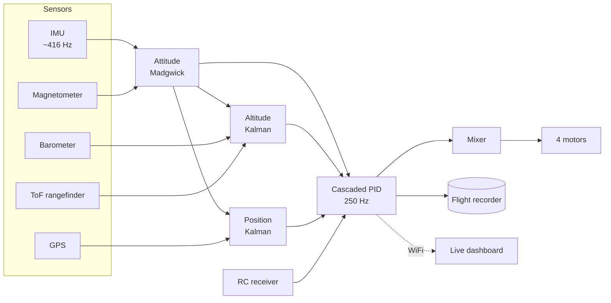

# Drone_FlightCont

[](https://github.com/malek23ma/Drone_FlightCont/actions/workflows/build.yml)


A quadcopter flight controller I wrote from scratch for the ESP32-S3: sensor drivers, sensor fusion, cascaded PID and motor output. There is no Betaflight or ArduPilot underneath.

<!-- PHOTO: docs/img/drone.jpg goes here -->

> **Experimental firmware.** It has flown and it has crashed. Do not put it on an aircraft you care about.

## Highlights

- **Written from scratch in C** on ESP-IDF and FreeRTOS: 9 sensor and radio drivers, estimation, control, safety and logging.
- **Sensor fusion:** a Madgwick attitude filter, plus Kalman filters for altitude (accelerometer, barometer, ToF) and for GPS position.
- **Control:** cascaded PID, angle loop into rate loop, at 250 Hz into a Quad-X mixer.
- **Tooling:** a 250 Hz flight recorder on microSD, a live WiFi dashboard on a second board, and Python tools to decode and replay flights.
- **Tested on a PC:** the real estimator and controller code runs in host tests against recorded flights, in CI on every push.

## How it works



## Status

- [x] Manual flight with a pre-arm check, failsafes and a watchdog
- [x] Flight recorder, live dashboard and replay tools
- [ ] Port to the STM32H753 (in progress)
- [ ] Optical-flow position hold (written, not flown yet)
- [ ] A custom PCB instead of the hand-wired harness

## Build and flash

Needs [ESP-IDF v5.5](https://docs.espressif.com/projects/esp-idf/en/stable/esp32s3/get-started/).

```bash
idf.py set-target esp32s3
idf.py build
idf.py -p <PORT> flash monitor
```

Do not run `erase_flash`: the parameters and the magnetometer calibration live in flash.

## Details

<details>
<summary><b>Hardware</b></summary>

| | |
|---|---|
| Weight | 1173 g |
| Motors | 4x SunnySky X2212 980 kV, APC 9045 props |
| ESC | Eachine 30A BLHeli_S 4-in-1, PWM 400 Hz |
| Battery | 4S |
| Hover throttle | ~1460 µs at 16.2 V (~30 % of max thrust) |
| Thrust-to-weight | 3.38 |
| Flight controller | ESP32-S3 DevKitC-1 (16 MB flash, 8 MB PSRAM) |
| Telemetry bridge | ESP32-C6 (XIAO) over UART, serving the dashboard |

</details>

<details>
<summary><b>Sensors and pins</b></summary>

| Device | Role | Bus | Address / pins |
|---|---|---|---|
| LSM6DSOX | IMU | SPI2 @ 10 MHz | MOSI 4, SCK 5, MISO 6, CS 7; INT1 on GPIO 15 |
| DPS310 | Barometer | I2C bus A (SDA 17 / SCL 18) | 0x77 |
| INA226 | Pack voltage | I2C | 0x40 |
| MMC5603 | Magnetometer | I2C bus B (SDA 13 / SCL 14) | 0x30 |
| VL53L0X | ToF rangefinder | I2C bus B | 0x29 |
| MS5611 | Second barometer (not used for flight) | I2C bus B | 0x76 / 0x77 |
| PMW3901 | Optical flow | SPI3 | CS 16 |
| TBS M10 | GPS | UART0 @ 38400 | TX 1, RX 2 |
| microSD | Flight recorder | SPI3 @ 10 MHz | CS 42, SCK 41, MOSI 40, MISO 39 |
| FS-iA6B | RC receiver (iBUS) | UART1 | GPIO 8 |
| ESCs | M1 FR CW, M2 FL CCW, M3 RR CCW, M4 RL CW | LEDC 400 Hz | GPIO 9, 10, 11, 12 |
| ESP32-C6 | Telemetry link | UART2 @ 921600 | TX 47, RX 21 |

</details>

<details>
<summary><b>Software</b></summary>

**Estimation.** Madgwick attitude filter (falls back to 6-DOF if the magnetometer reading looks wrong), gyro low-pass and notch filters, a 4-state altitude Kalman filter and a 6-state horizontal filter with GPS.

**Control.** Angle loop into a rate PID with derivative on measurement and anti-windup, then a Quad-X mixer with airmode. Altitude hold and velocity hold exist and are off by default.

**Safety.** The aircraft only arms when it is still, level, with throttle low, sensors alive and the recorder ready. It disarms on RC link loss, stale sensor data, a frozen IMU or a NaN on the motor path. A 200 ms task watchdog covers the flight loops.

| Task | Core | Rate | Job |
|---|---|---|---|
| fusion | 1 | ~416 Hz (IMU interrupt) | IMU, filters, attitude, altitude, position |
| flight | 1 | 250 Hz | PID, mixer, arming, recorder frame |
| slow_sensor | 0 | 50 Hz | barometer, magnetometer, voltage, ToF |
| gps / rx | 0 | on data | GPS and RC decoding |
| telemetry | 0 | 4 Hz | data to the dashboard, commands from it |
| bb_writer | 0 | queued | recorder writes to the SD card |

</details>

<details>
<summary><b>Console, logs and tests</b></summary>

The console works over USB and through the dashboard. `HELP` lists the commands (`STATS`, `GYROCAL`, `LEVELCAL`, `GET` / `SET` / `SAVE`, `MOT`, `BBDUMP` and more).

Flight logs: `tools/blackbox_pull.py <PORT>` downloads them and `tools/blackbox_decode.py` splits them into one CSV per flight.

Host tests (Windows, clang, Python 3.11+) compile the real firmware sources:

```bash
python tools/vert_ctest.py
python tools/vert_replay.py tools/fixtures/logA_s23.csv.gz
python tools/horiz_ctest.py
python tools/pid_windup_test.py
python tools/params_migrate_test.py
```

</details>

<details>
<summary><b>Repository layout</b></summary>

| Path | Contents |
|---|---|
| `main/` | entry point, flight task, arming, console |
| `components/` | drivers, fusion, filters, PID, mixer, motors, flight recorder, parameters, GPS monitor |
| `tools/` | Python tools: log download and decode, calibration, replay, host tests |
| `tools/c6_wifi_rc/` | ESP32-C6 telemetry bridge and dashboard |

</details>

## License

MIT, see [LICENSE](LICENSE).
